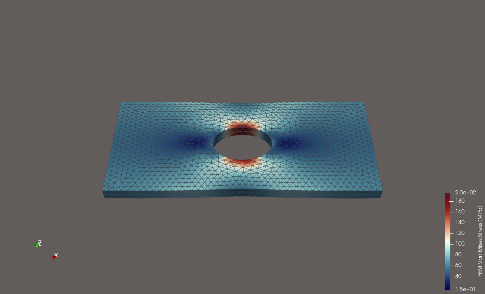
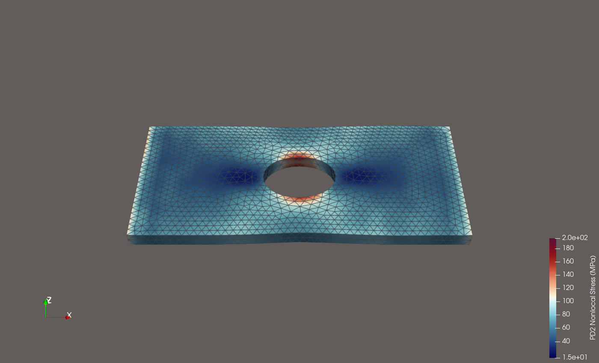
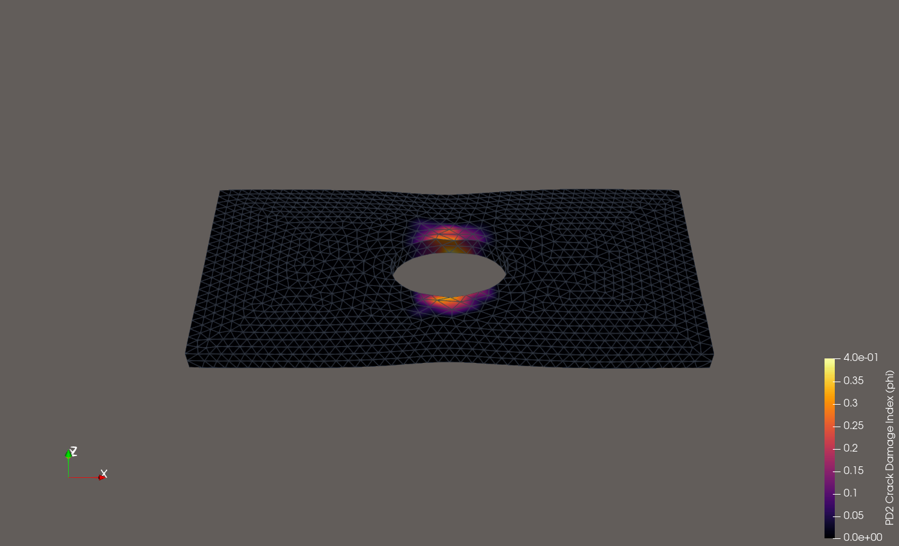
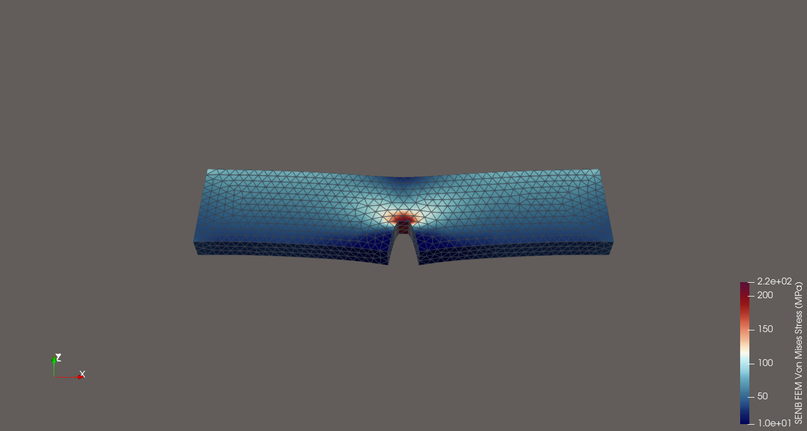
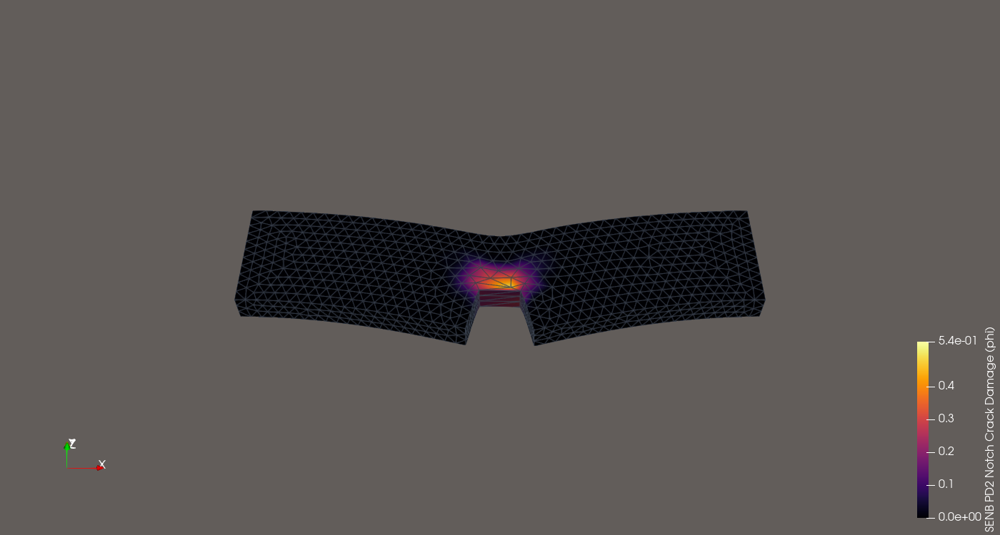
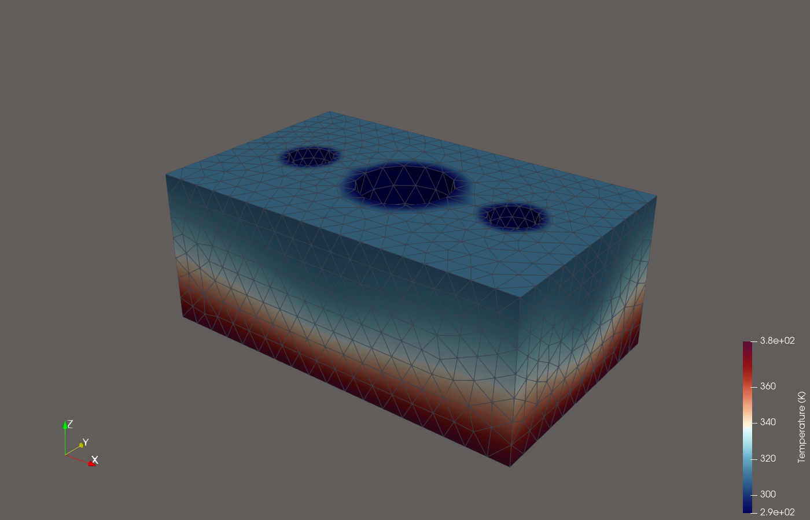
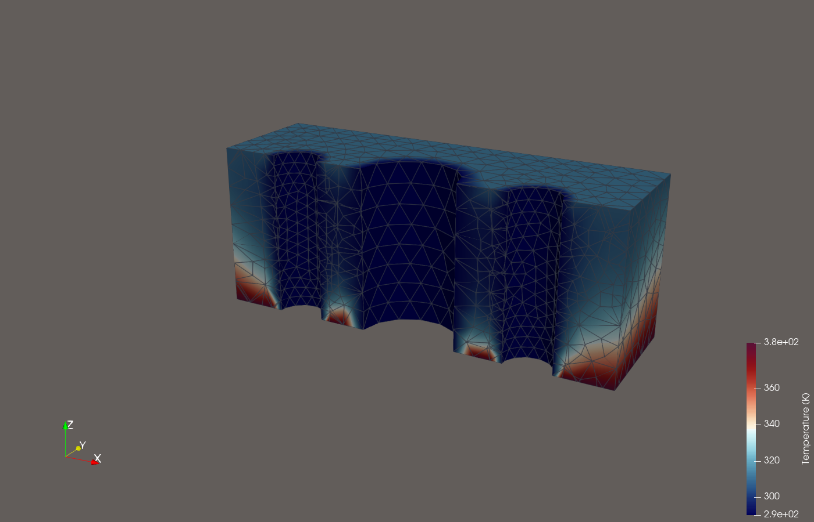
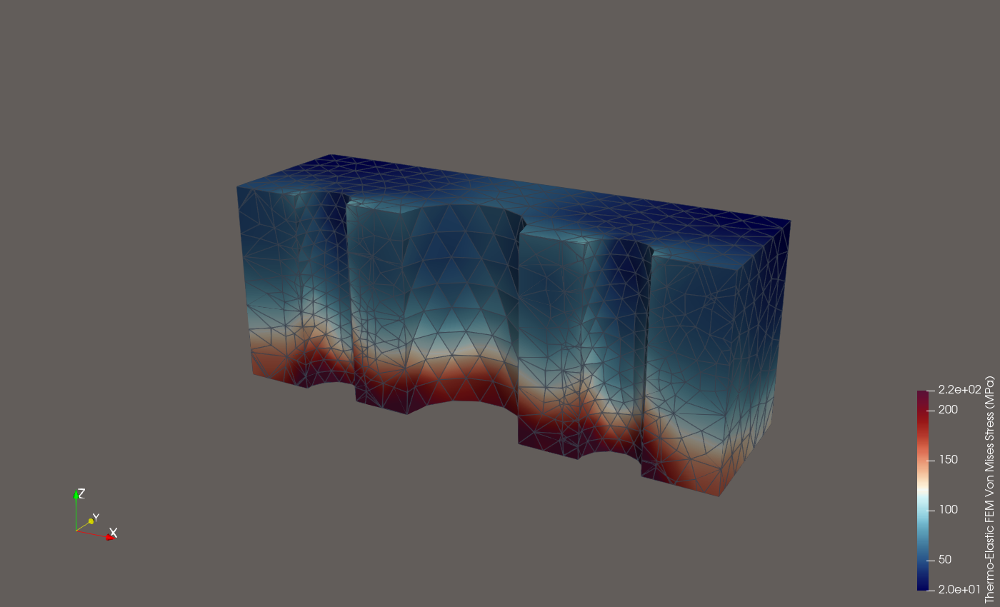
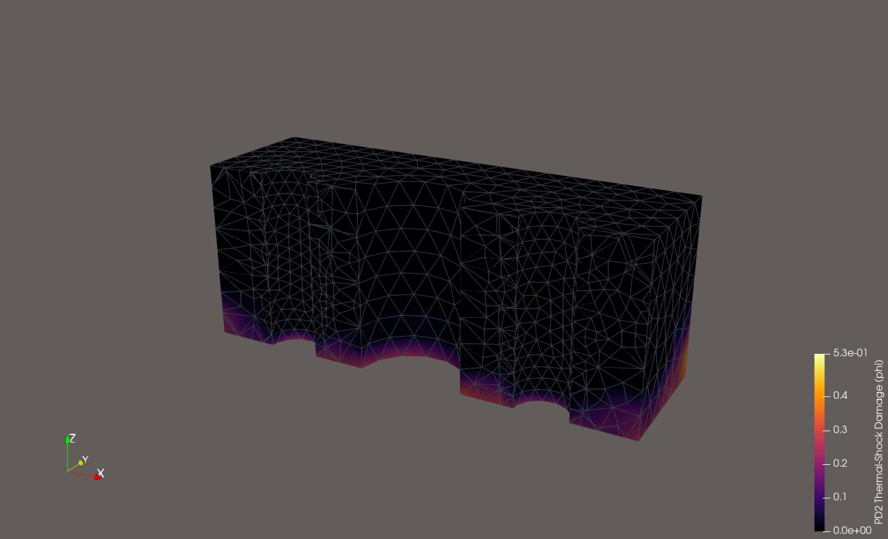

# SALOME Platform — Native macOS Apple Silicon (`arm64`) Port & 3D FEM vs. Peridynamics (`PD2`) Benchmarks

Native macOS (`arm64`) port, build environment, and 3D engineering benchmarks for all **44 open-source SALOME modules** (SALOME 9.15 / master) + custom prerequisites (`OpenCASCADE 7.8.1`, `ParaView 6.0`, `MEDfile 6.0.1`, `SOLVERLAB` with `PETSc 3.26` & `SLEPc 3.26`, `Netgen 6.2`, `Gmsh 4.15`, `PyQt5` + `SIP`, `Qwt`, `omniORB`).

---

## Prebuilt Binaries (macOS `arm64`)

Download `salome-macos-arm64-binaries.tar.gz` (`611 MB`) from the [**Releases**](../../releases/tag/v9.15.0-macos-arm64) tab and extract it in the repository root:

```bash
tar -xzf salome-macos-arm64-binaries.tar.gz
```

---

## 3D Engineering Benchmark Reports: Finite Element Method (FEM) vs. Peridynamics (`PD2`)

All benchmarks run end-to-end through the native macOS `arm64` SALOME pipeline:
1. **Stage 1 (`SHAPER` + `GEOM`)**: 3D Parametric CAD construction & analytical volume verification.
2. **Stage 2 (`SMESH` + `NETGEN_1D2D3D`)**: 3D unstructured tetrahedral meshing exported to `.med`.
3. **Stage 3 (`MEDCoupling` + `SOLVERLAB` / `SciPy`)**: 3D Linear Elastic / Thermal **FEM ($P_1$)** vs. 3D Nonlocal **Bond-Based Peridynamics (`PD2`)** with autonomous bond-stretch fracture ($\varphi \in [0, 1]$).
4. **Stage 4 (`PARAVIS` / `ParaView` + `MEDReader.so`)**: 3D offscreen visualization & cutaway rendering.

---

### Benchmark 1: 3D Perforated Plate under Uniaxial Tension (`examples/fem_vs_peridynamics.py`)

```bash
./salome python examples/fem_vs_peridynamics.py
```

- **Geometry**: $0.20\text{ m} \times 0.10\text{ m} \times 0.01\text{ m}$ aluminum plate ($E = 71.7\text{ GPa}, \nu = 0.25$) with central circular hole $R = 0.02\text{ m}$ (`2,531` nodes, `7,550` tetrahedra, `7,593` DOFs).
- **Loading**: Uniaxial tensile displacement $u_x(0, y, z) = -0.10\text{ mm}$, $u_x(L_x, y, z) = +0.10\text{ mm}$ ($\sigma_0 = 71.70\text{ MPa}$).

| Metric | 3D FEM ($P_1$ Continuum) | 3D Peridynamics (`PD2`, $\delta = 12.6\text{ mm}$) | Comparison / Engineering Note |
| :--- | :---: | :---: | :--- |
| **Max Axial Displacement $\|u_x\|$** | $0.1000\text{ mm}$ | $0.1000\text{ mm}$ | Global $L^2$ displacement diff $= 6.57\%$ |
| **Max Transverse Contraction $\|u_y\|$** | $0.0303\text{ mm}$ | $0.0342\text{ mm}$ | Poisson lateral contraction ($\nu = 0.25$) |
| **Mean Von Mises Stress** | $65.61\text{ MPa}$ | $66.19\text{ MPa}$ | Global equilibrium agrees within **$0.88\%$** |
| **Peak Axial Stress $\sigma_{xx,\max}$** | $197.15\text{ MPa}$ ($K_t = 2.75$) | $164.07\text{ MPa}$ | Nonlocal horizon regularizes hole-rim peak |
| **Peak Von Mises Stress $\sigma_{\text{VM},\max}$** | $186.37\text{ MPa}$ | $166.27\text{ MPa}$ | Nonlocal smoothing over $\sim 40.2$ bonds/node |
| **Crack Initiation Damage $\varphi_{\max}$** | N/A (Continuum) | **$0.401$** (`237` broken bonds) | Autonomous symmetric tensile crack initiation |

| 3D FEM Von Mises Stress (MPa) | 3D Peridynamics (`PD2`) Stress (MPa) | 3D Peridynamics (`PD2`) Crack Damage ($\varphi$) |
| :---: | :---: | :---: |
|  |  |  |

---

### Benchmark 2: 3D Single-Edge Notched Beam (SENB) Mode-I Fracture (`examples/notched_beam_fem_vs_pd.py`)

```bash
./salome python examples/notched_beam_fem_vs_pd.py
```

- **Geometry**: $0.16\text{ m} \times 0.04\text{ m} \times 0.01\text{ m}$ beam with a bottom mid-span pre-notch of width $3\text{ mm}$ and depth $a = 16\text{ mm}$ ($a/W = 0.40$, `1,605` nodes, `5,188` tetrahedra).
- **Peridynamics Discontinuity**: Nonlocal bonds crossing the pre-notch slot are severed geometrically at initialization, and overloaded bonds at the notch tip break progressively across 3 fracture steps.

| Metric | 3D FEM ($P_1$ Continuum) | 3D Peridynamics (`PD2`) | Comparison / Engineering Note |
| :--- | :---: | :---: | :--- |
| **Mean Von Mises Stress** | $58.88\text{ MPa}$ | $60.59\text{ MPa}$ | $2.9\%$ difference in global stress state |
| **Peak Notch-Tip Von Mises Stress** | $224.73\text{ MPa}$ | $198.25\text{ MPa}$ | Elastic $L^2$ displacement diff $= 8.71\%$ |
| **Notch-Tip Crack Damage $\varphi_{\max}$** | N/A (Continuum) | **$0.537$** (`374` broken bonds) | Upward Mode-I crack propagation from notch tip |

| 3D SENB FEM Von Mises Stress (MPa) | 3D SENB Peridynamics (`PD2`) Notch Crack Propagation ($\varphi$) |
| :---: | :---: |
|  |  |

---

### Benchmark 3: 3D Multi-Channel Thermal Cooling Block & Coupled Thermo-Mechanical Shock (`examples/thermal_cooling_block.py` & `examples/thermo_mechanical_fem_vs_pd.py`)

```bash
./salome python examples/thermal_cooling_block.py
./salome python examples/thermo_mechanical_fem_vs_pd.py
```

- **Geometry**: $0.10\text{ m} \times 0.06\text{ m} \times 0.04\text{ m}$ aluminum cooling block ($k = 205\text{ W/(m}\cdot\text{K)}$, $\alpha = 23.1 \times 10^{-6}\text{ K}^{-1}$) with 3 cylindrical coolant channels ($R_1 = 12\text{ mm}$, $R_{2,3} = 6\text{ mm}$; `2,215` nodes, `8,716` tetrahedra).
- **Thermal Solution**: Heated base at $385\text{ K}$, internal coolant walls at $290\text{ K}$, top face at $310\text{ K}$, internal heat generation $q = 1.5\text{ MW/m}^3$ ($T_{\text{mean}} = 321.31\text{ K}$).
- **Coupled Thermo-Mechanical Comparison**: Feeds the 3D temperature field $T(\mathbf{x})$ into both 3D Thermo-Elastic **FEM** ($\boldsymbol{\sigma} = \mathbf{D} : (\boldsymbol{\varepsilon} - \alpha \Delta T \mathbf{I})$) and 3D Thermo-Mechanical **Peridynamics (`PD2`)** ($s_{\text{mech},ij} = s_{ij} - \alpha \Delta T_{ij}$).

| Metric | 3D Thermo-Elastic FEM | 3D Thermo-Mechanical Peridynamics (`PD2`) | Comparison / Engineering Note |
| :--- | :---: | :---: | :--- |
| **Max Thermal Expansion $\|u\|_{\max}$** | $0.0570\text{ mm}$ | $0.0646\text{ mm}$ | $L^2$ displacement diff $= 16.14\%$ |
| **Mean Thermal Von Mises Stress** | $85.66\text{ MPa}$ | $75.39\text{ MPa}$ | Induced by $\Delta T = 95\text{ K}$ base-to-channel gradient |
| **Peak Thermal Von Mises Stress** | $292.42\text{ MPa}$ | $234.11\text{ MPa}$ | Concentrated at heated base / chilled channel junction |
| **Thermal-Shock Bond Damage $\varphi_{\max}$** | N/A (Continuum) | **$0.525$** (`2,565` broken thermal bonds) | Predicts thermal-shock microcracking at bottom channel rims |

| 3D Exterior Temperature Field (K) | 3D Mid-Plane Cutaway Temperature (K) |
| :---: | :---: |
|  |  |

| 3D Coupled Thermo-Elastic FEM Stress (MPa) | 3D Peridynamics (`PD2`) Thermal-Shock Damage ($\varphi$) |
| :---: | :---: |
|  |  |

---

## Launching SALOME Interactively

```bash
# Interactive shell with all 44 SALOME modules on PATH / PYTHONPATH / DYLD_LIBRARY_PATH:
./salome shell

# Launch the SALOME desktop GUI:
./salome
```
