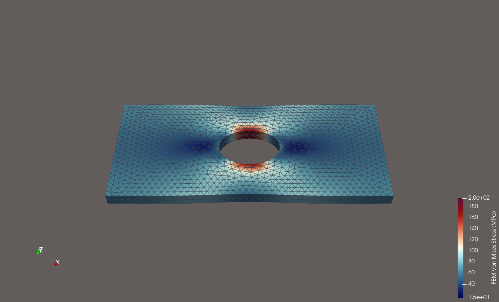
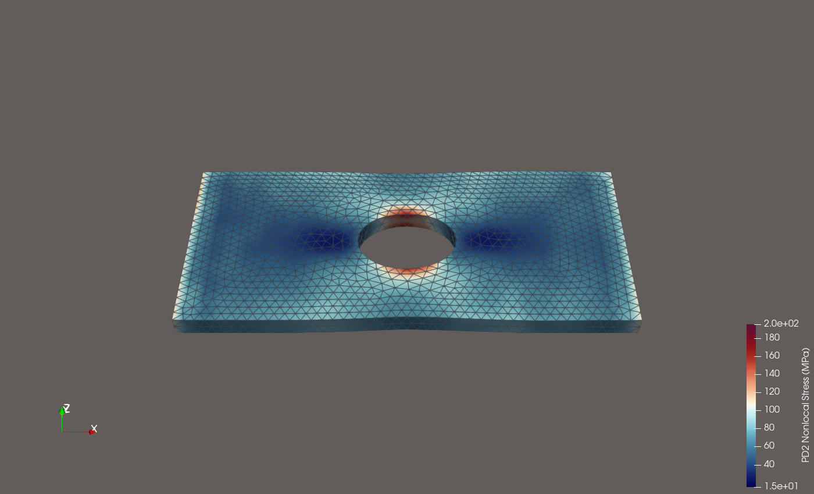
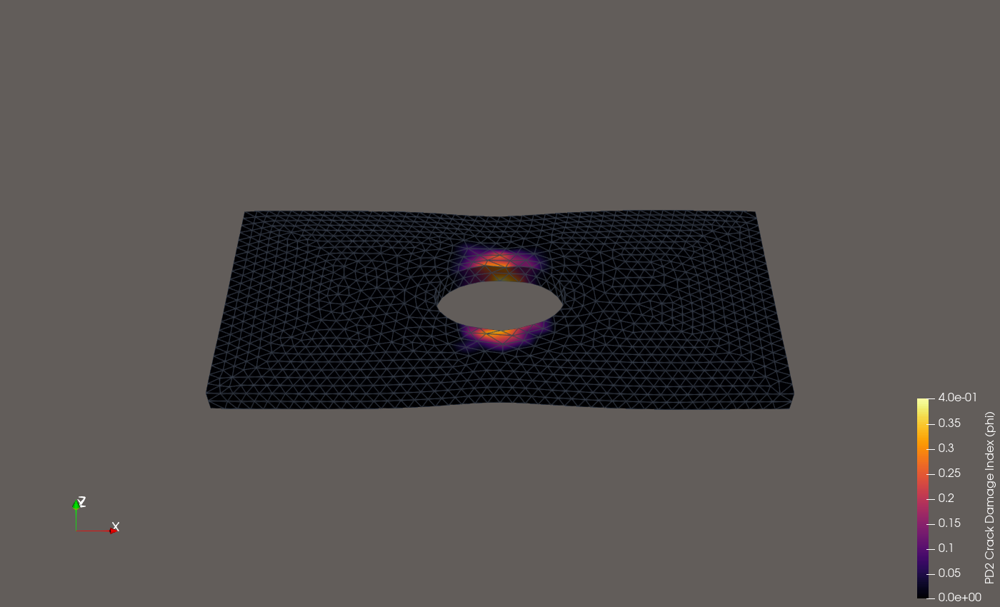
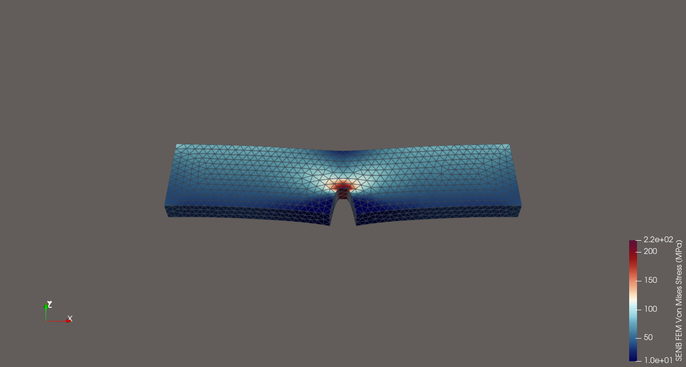
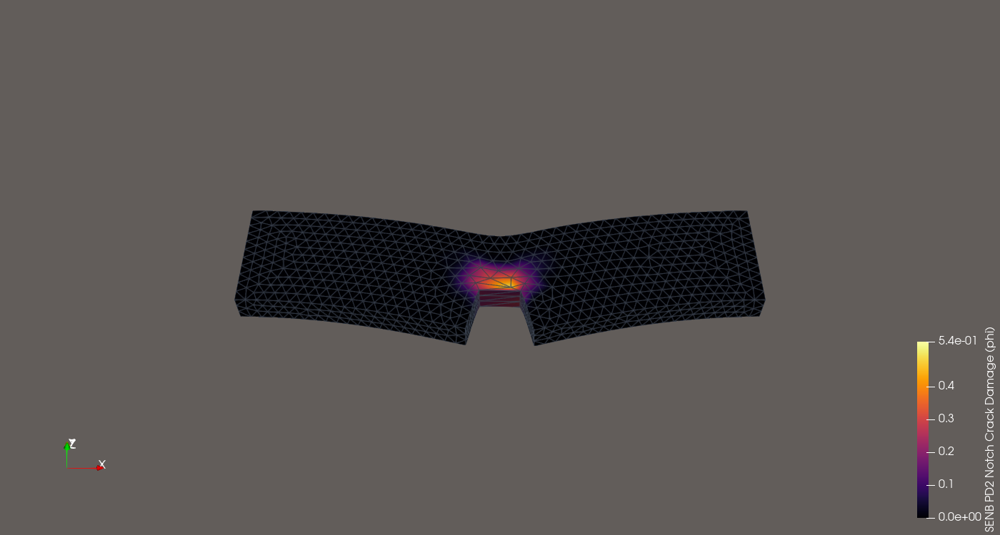
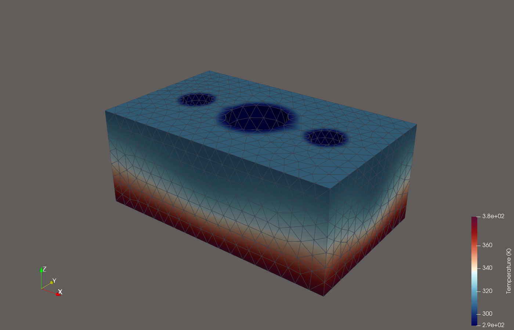
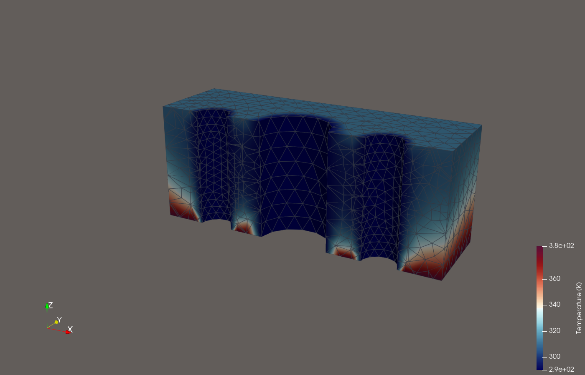
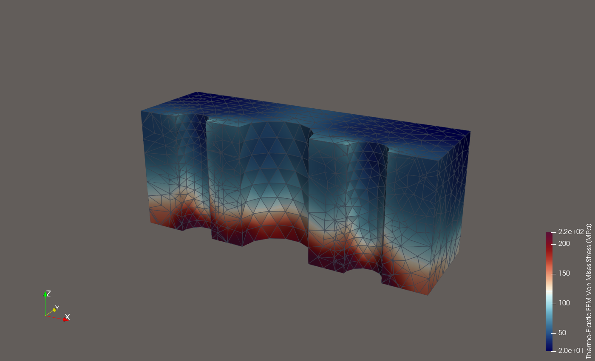
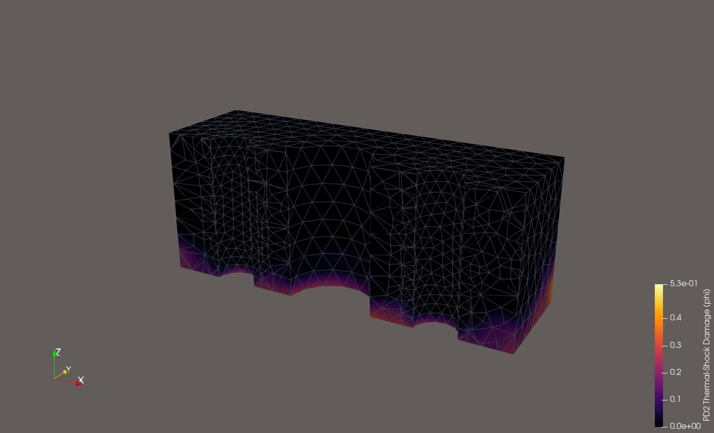

# Detailed Engineering Report: 3D FEM vs. Peridynamics (`PD2`) in SALOME

This directory contains four complete 3D engineering simulations built and executed natively on macOS Apple Silicon (`arm64`) using the compiled **SALOME Platform** (`SHAPER` + `GEOM` + `SMESH`/`NETGEN_1D2D3D` + `MEDCoupling`/`SOLVERLAB` + `PARAVIS`/`MEDReader.so`):

1. [`fem_vs_peridynamics.py`](fem_vs_peridynamics.py) — **3D Perforated Plate under Uniaxial Tension (Kirsch Stress Concentration & Crack Initiation)**
2. [`notched_beam_fem_vs_pd.py`](notched_beam_fem_vs_pd.py) — **3D Single-Edge Notched Beam (SENB) Mode-I Crack Propagation**
3. [`thermal_cooling_block.py`](thermal_cooling_block.py) — **3D Multi-Channel Thermal Cooling Block Steady-State Conduction**
4. [`thermo_mechanical_fem_vs_pd.py`](thermo_mechanical_fem_vs_pd.py) — **3D Coupled Thermo-Mechanical Shock Stress & Cracking**

---

## Summary Comparison Table Across All Benchmarks

| Benchmark Case | Mesh (`SMESH` / `NETGEN`) | 3D FEM Peak Von Mises | 3D PD2 Peak Von Mises | 3D FEM Mean Stress | 3D PD2 Mean Stress | Elastic $L^2$ Disp. Diff | PD2 Fracture Damage $\varphi_{\max}$ |
| :--- | :---: | :---: | :---: | :---: | :---: | :---: | :---: |
| **1. Perforated Plate Tension** | `2,531` nodes / `7,550` tetras | $186.37\text{ MPa}$ | $166.27\text{ MPa}$ | $65.61\text{ MPa}$ | $66.19\text{ MPa}$ | **$6.57\%$** | $0.401$ (`237` broken bonds) |
| **2. Single-Edge Notched Beam** | `1,605` nodes / `5,188` tetras | $224.73\text{ MPa}$ | $198.25\text{ MPa}$ | $58.88\text{ MPa}$ | $60.59\text{ MPa}$ | **$8.71\%$** | $0.537$ (`374` broken bonds) |
| **3. Coupled Thermo-Mechanical** | `2,215` nodes / `8,716` tetras | $292.42\text{ MPa}$ | $234.11\text{ MPa}$ | $85.66\text{ MPa}$ | $75.39\text{ MPa}$ | **$16.14\%$** | $0.525$ (`2,565` broken bonds) |

---

## Visual Gallery

### 1. Perforated Plate (3D FEM vs. Peridynamics `PD2`)

### 2. Single-Edge Notched Beam (3D FEM vs. Peridynamics `PD2`)

### 3. Thermal Cooling Block & Coupled Thermo-Mechanical Shock

