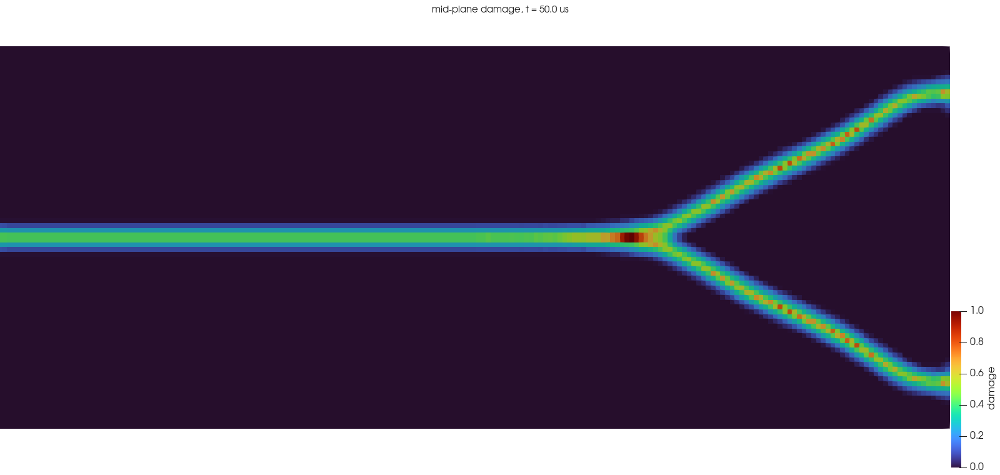
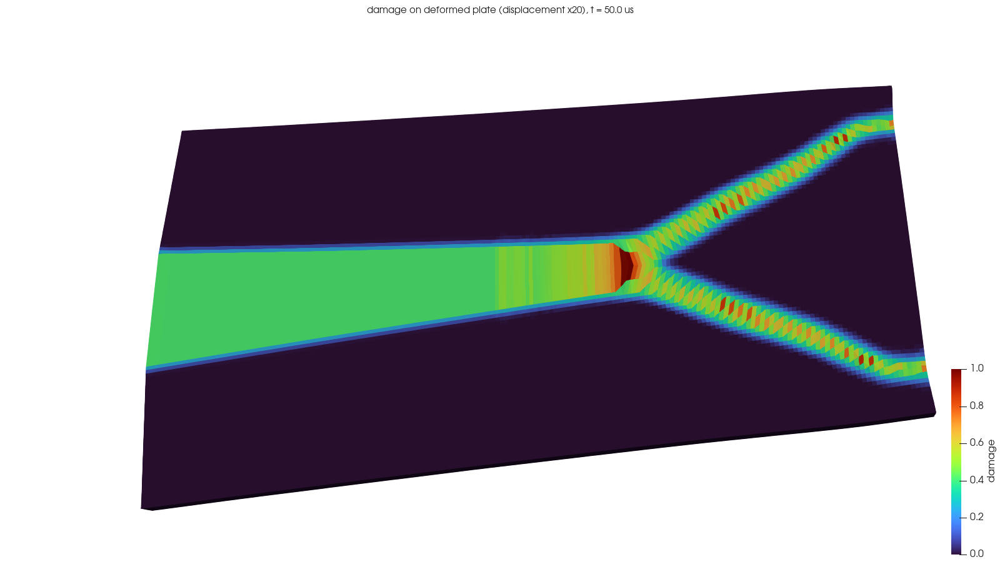

# pd_dynamic — dynamic peridynamics inside SALOME

GEOM / SHAPER geometry → SMESH mesh → **libpdcore** (explicit dynamic ordinary state-based PD,
C++/OpenMP) → MED time series → PARAVIS / ParaView.

One PD node per 3D mesh cell (centroid, cell volume). A structured hex mesh gives the usual
uniform PD grid; any SMESH 3D mesh works (for tets, pass a representative `dx` for the
partial-volume factor).

## Build and run
    ./pd_dynamic/build.sh                                              # libpdcore.dylib
    OMP_NUM_THREADS=10 ./salome python pd_dynamic/examples/branching_3d_elastic.py [dx_mm h_mm t_us m]
    ./salome python pd_dynamic/render.py pd_dynamic/results/<run>      # re-render PNGs only
Defaults: dx = 0.5 mm, h = 2.5 mm (5 layers), 50 µs, m = 4. 80 000 nodes, 14.1 M bonds,
5000 steps; 27 s on 10 threads, about 35 s for the whole pipeline.
Open `results/<run>/solution.med` in the SALOME GUI (PARAVIS) to animate Damage / Displacement / Velocity.

## Result: 3D dynamic crack branching (elastic, Duran 50 glass)
100 x 40 x 2.5 mm plate, dx = 0.5 mm, horizon 4 dx, 12 MPa step traction, 50 µs.
Branches start at x = 70.8 mm and reach |y| = 15.2 mm; damage is exactly mirror-symmetric.

The `.med` files (solution 102 MB) are not in git; the example regenerates them in about 35 s.
`final_state.npz` holds X, vol, phi, u, v at 50 µs, and `run.log` is the full console output.

## Model (same as ~/Desktop/pd/Ordinery-SB-3d/main_osb3d.cpp)
    e    = |xi + eta| - |xi|
    m_i  = sum w |xi|^2 beta V_j,        th_i = (3/m_i) sum w |xi| e beta V_j
    t_ij = w (A_i th_i |xi| + B_i e),     A = (3K - 5mu)/m,  B = 15mu/m
    F_i  = sum (t_ij + t_ji) M_ij beta V_j + b
Velocity Verlet, w = R/|xi| (influence 0 → w = 1). Bonds break when e/|xi| > s0, with
s0 = sqrt(5 G0 / (6 E R)).

## Python API (pdsalome)
    pd = PDSolver(X, vol, R, dx); pd.set_material(E, nu, rho, s0)
    pd.add_precrack(p0, p1, p2)        # rectangle p0 + u(p1-p0) + v(p2-p0)
    pd.build()
    pd.traction(mask, [sx, sy, sz], layer_thickness)   # body force sigma / thickness
    pd.fix(mask, dofs)  |  pd.velocity(mask, dof, v)   |  pd.load_ramp(t)
    pd.apply(); pd.run(nsteps, dt); pd.u, pd.v, pd.a, pd.phi, pd.theta
Boundary codes per DOF: 0 fixed, 1 body force × f(t), 2 velocity (u = v t).
`MEDSeries(path, umesh).append(step, t, {...})` writes cell fields; `viz.render(med, dir)` writes PNGs.

## Checks done (2026-11-08)
- Plate case of main_osb3d (20 705 nodes, 5000 steps): **identical damage at all 50 outputs**
  (max |Δφ| = 5.6e-17, CSV rounding), max|u| 3.976e-4; 4.75 s vs 4.62 s for main_osb3d.
- Branching example: branches start at x = 70.8 mm and reach |y| ≈ 15 mm, **exactly mirror-symmetric**.
  This matches the 2D Mathematica symmetric run (≈70 mm, ±16 mm).
- m = 3 on the symmetric grid (0.5 or 1 mm) does not branch; m = 4 does.
  The main_osb3d plate does branch at m = 3, but only because its node row on y = 0 turns the
  pre-crack into a slot 2 dx wide.

## Pitfalls
- **Pre-crack edges on bond-crossing points.** Bonds cross the crack plane at multiples of
  dx/8 from cell faces. A pre-crack edge exactly there (e.g. tip at 50 mm, or 50 mm + dx/4)
  is decided by round-off, which breaks the mirror symmetry. Put edges off-grid (the example
  uses tip = 50 mm + 0.27 dx).
- **MEDReader** can activate only one time-step group (TS0/TS1...); `viz.open_med` selects the
  group that holds Damage.
- Do not name a script `inspect.py`: it hides Python's `inspect` and breaks numpy/medcoupling.

## Next: plasticity
In pass 2 of `pd_run`, add a plastic bond extension `e_p` per bond with a yield condition on
the deviatoric force state (Mitchell 2011, elastic–perfectly plastic OSB), and use
`e - e_p` in the deviatoric part. Output equivalent plastic strain as a MED field.
